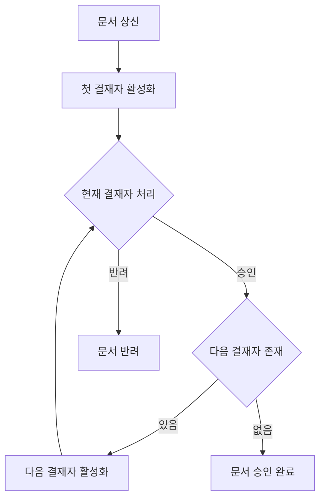
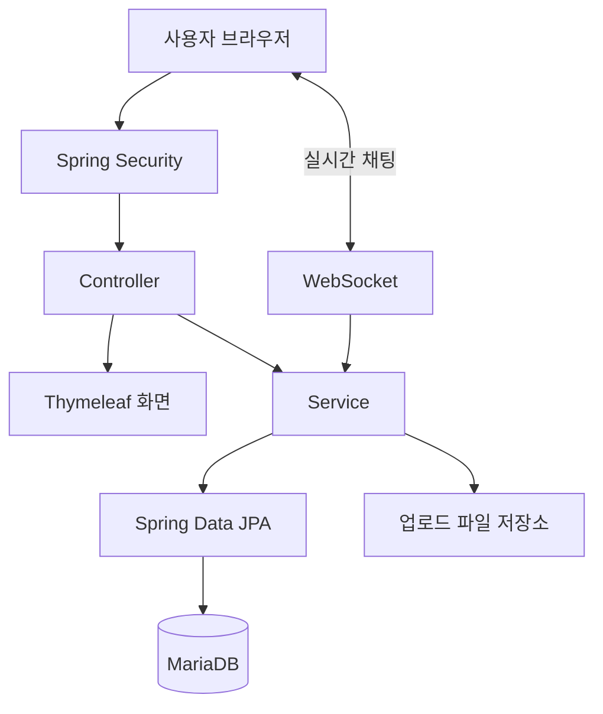

# Company Talk

### 전자결재부터 일정·근태·메신저까지, 사내 업무를 한곳에서

Spring Boot · Thymeleaf 기반 그룹웨어 팀 프로젝트

[프로젝트 소개](#프로젝트-소개) · [담당 기능](#담당-기능) · [구현 과정](#핵심-구현-과정) · [기술 스택](#기술-스택)

---

## 프로젝트 소개

Company Talk는 전자결재, 게시판, 일정, 근태 관리와 실시간 채팅을 통합한 사내 그룹웨어입니다. 직원은 업무 문서를 상신하고 결재 진행 상태를 확인하며, 게시판과 메신저를 통해 동료와 소통할 수 있습니다.

| 항목 | 내용 |
| --- | --- |
| 프로젝트 유형 | 풀스택 개발 교육 과정 팀 프로젝트 |
| 개발 인원 | 6명 |
| 개발 기간 | 약 2주 |
| 주요 담당 | 전자결재, 개인 결재라인, 사인 이미지, 결재 문서 첨부파일, 게시판 댓글·대댓글, 접근 거부 처리 |

<!-- 실제 화면을 준비한 뒤 아래 주석을 해제하세요. 저장소 루트에 docs/images 폴더를 만들고 이미지를 추가하면 됩니다.

-->

## 주요 기능

아래는 팀 전체가 구현한 서비스 기능입니다.

| 영역 | 주요 기능 |
| --- | --- |
| 전자결재 | 문서 작성·임시저장·상신, 순차 승인·반려, 개인 결재라인 및 사인 이미지 관리 |
| 게시판 | 게시글 작성·조회·수정, 댓글·대댓글 |
| 일정 | 캘린더 기반 일정 조회 및 관리 |
| 근태·휴가 | 출퇴근 기록, 휴가 신청 및 내역 조회 |
| 메신저 | WebSocket 기반 실시간 채팅, 채팅방 및 참여자 관리 |
| 조직·관리 | 조직도, 직원 조회, 관리자용 직원·부서·직급 관리 |

## 담당 기능

**전자결재의 업무 흐름과 관련 데이터 처리를 구현하고, 게시판 댓글 및 접근 거부 처리를 담당했습니다.**

| 담당 영역 | 구현 내용 |
| --- | --- |
| 전자결재 | 문서 임시저장·상신·조회·수정·삭제, 결재 순서에 따른 승인·반려 처리 |
| 결재라인 | 사용자별 결재라인 및 결재자 순서 관리, 상신 시 문서별 결재 단계 생성 |
| 사인 이미지 | 사용자별 이미지 등록·교체·조회·삭제, 파일 형식·크기 확인 |
| 첨부파일 | 결재 문서 첨부파일 등록·조회·삭제 및 접근 조건 확인 |
| 댓글·대댓글 | 부모 댓글 참조를 이용한 답글 구현, 답글이 있는 댓글의 삭제 제한 |
| 접근 거부 처리 | 관리자 페이지에 권한 없이 접근했을 때 사용자 안내 및 이동 처리 |

## 핵심 구현 과정

### 1. 결재 순서에 따라 문서 상태 전환

여러 결재자가 등록된 문서는 **현재 차례인 결재자만 처리할 수 있도록** 구현했습니다. 문서 상태와 결재자별 상태를 분리하고, 승인 시 다음 대기자를 활성화합니다. 마지막 결재자가 승인하면 문서를 완료 처리하고, 반려 시에는 문서 상태를 반려로 변경합니다.

- 최초 결재자는 `PENDING`, 이후 결재자는 `WAITING` 상태로 생성합니다.
- 승인·반려 요청에서는 문서 진행 상태와 요청자의 현재 결재 차례를 확인합니다.
- 결재 처리 이력이 있거나 종료된 문서는 수정·삭제를 제한합니다.
- 문서와 결재 단계의 상태 변경은 서비스의 트랜잭션 안에서 처리합니다.

[구현 코드 — ApprovalDocumentService](groupware/src/main/java/com/company/groupware/service/ApprovalDocumentService.java)

### 2. 개인 결재라인과 문서별 결재 이력 분리

반복해서 사용할 개인 결재라인과 실제 문서에 적용되는 결재 단계를 별도로 관리합니다. 상신 시 선택한 라인의 결재자와 순서를 문서별 결재 데이터로 복사하여, 이후 개인 결재라인 변경이 기존 문서의 결재 순서에 직접 영향을 주지 않도록 구성했습니다.

| 데이터 | 역할 |
| --- | --- |
| `ApprovalLine` / `ApprovalLineMember` | 사용자가 관리하는 결재라인과 결재자 순서 |
| `ApprovalDocument` / `ApprovalDocumentMember` | 상신된 문서와 해당 문서의 결재자별 처리 상태 |

상신 시에는 선택한 결재라인이 작성자 본인의 라인인지, 결재자가 등록되어 있는지 확인합니다.

[구현 코드 — ApprovalLineService](groupware/src/main/java/com/company/groupware/service/ApprovalLineService.java)

### 3. 파일과 댓글의 예외 상황 처리

**사인 이미지**는 이미지 MIME 타입과 5MB 크기 제한을 확인하고, UUID를 포함한 저장 파일명을 사용합니다. 이미지를 교체하거나 삭제할 때는 기존 실제 파일도 정리합니다.

**댓글·대댓글**은 부모 댓글을 참조하는 구조로 구현했습니다. 답글이 있는 부모 댓글을 삭제하려는 경우에는 `409 Conflict`를 반환하여 삭제를 제한합니다.

[사인 이미지 구현](groupware/src/main/java/com/company/groupware/service/ApprovalSignatureService.java) · [첨부파일 구현](groupware/src/main/java/com/company/groupware/service/ApprovalDocumentAttachmentService.java) · [댓글 구현](groupware/src/main/java/com/company/groupware/service/BoardCommentService.java)

## 시스템 구성

Thymeleaf로 화면을 구성하고, HTTP 요청은 Controller–Service–Repository 계층을 통해 처리합니다. 실시간 채팅에는 WebSocket을 사용하며, 업로드 파일은 파일시스템에 저장합니다.

## 기술 스택

| 구분 | 기술 |
| --- | --- |
| 언어 | Java 21, JavaScript, HTML, CSS |
| 백엔드 | Spring Boot, Spring MVC, Spring Data JPA, Spring Security, Bean Validation, Lombok |
| 프론트엔드 | Thymeleaf, JavaScript |
| 실시간 통신 | WebSocket |
| 데이터베이스 | MariaDB |
| 빌드 | Gradle |
| 개발 환경 | Windows 11, Docker |
| 형상 관리·협업 | Git, GitHub, Slack |

> Java 버전은 저장소의 `build.gradle` 기준입니다. Docker는 개발 과정에서 사용한 환경이며, 위 구성도는 애플리케이션의 논리 구조를 나타냅니다.

<!-- 화면 캡처 추가 예시: 이미지 파일을 업로드한 다음 이 주석을 해제하세요.
## 주요 화면

### 전자결재 문서 작성

### 결재 진행 상태

### 개인 결재라인

-->
